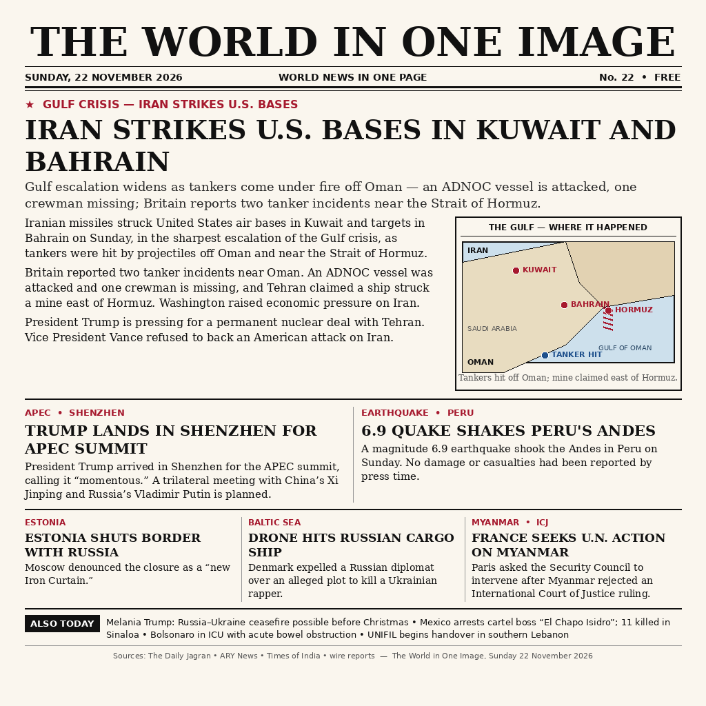

# The World in One Image — 22 November 2026

[](https://make.fun/bounty/news-image-20261122)
[](https://make.fun/bounty/news-image-20261122)
[](https://make.fun/bounty/news-image-20261122)

A one-page newspaper front page summing up the world's news of
Sunday, 22 November 2026 — drawn entirely in code.

Bounty: [Sum up 22 November's world news in one image](https://make.fun/bounty/news-image-20261122)



## What's on the page

- **Lead:** Iran strikes U.S. air bases in Kuwait and targets in Bahrain;
  Gulf escalation widens as tankers come under fire off Oman and near the
  Strait of Hormuz — an ADNOC vessel attacked, one crewman missing.
- **APEC, Shenzhen:** Trump lands for the summit; a trilateral meeting
  with Xi Jinping and Vladimir Putin is planned.
- **Peru:** a magnitude 6.9 earthquake shakes the Andes; no damage or
  casualties reported yet.
- **Also in brief:** Estonia shuts its border with Russia; a drone hits a
  Russian cargo ship in the Baltic; France seeks U.N. Security Council
  action after Myanmar rejects an ICJ ruling — plus the "Also Today"
  ticker (Melania Trump on a possible ceasefire, the "El Chapo Isidro"
  arrest in Mexico, Bolsonaro in ICU, UNIFIL handover in Lebanon).

## Run it

```sh
python3 main.py
```

Writes `/output/entry.png` (1024×1024 PNG, ≤ 1 MiB). The program is
fully deterministic: running it twice produces byte-identical output —
no randomness, no timestamps, no network. If Pillow is not installed,
it falls back to copying the bundled `entry.png` to the output path.

## License

MIT — see [LICENSE](LICENSE).
